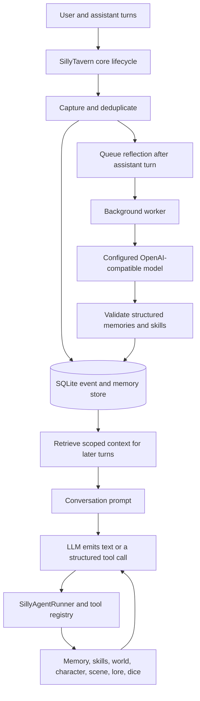

# SillyAgent

**A community-maintained SillyTavern fork with a native, core-integrated agent runtime.**

> **This is a fork of [SillyTavern](https://github.com/SillyTavern/SillyTavern).** It retains upstream SillyTavern code and adds fork-specific changes plus the SillyAgent integration. It is not an official SillyTavern release.

SillyTavern remains the application foundation: its web UI, conversation model, provider integrations, and user-data system are retained. This fork adds SillyAgent as a first-party backend/core feature, not as a browser extension.

## What is SillyAgent?

SillyAgent is a native harness and agent runtime for structured tool use, persistent memory, procedural skills, and roleplay state. It is integrated with SillyTavern's conversation lifecycle and backend API.

- **Native tool loop:** structured model tool calls are executed through a validated registry, with bounded tool rounds and call counts.
- **Automatic memory capture:** SillyTavern message lifecycle events capture user and assistant turns into scoped, deduplicated storage.
- **Background reflection:** when configured and enabled, a backend worker reviews bounded conversation context and can create durable memories or reusable procedural skills.
- **Persistent roleplay state:** tools can read and update world, character, and scene state, plus search lore and roll dice.
- **Lifecycle-aware deletion:** chat and character deletion clean up their associated state and block late requests from silently restoring deleted records.
- **Scoped context:** memory partitions are scoped to the active character/chat so unrelated conversations aren't casually merged.

## How the flow works



**No trigger word is needed.** Capture is driven by internal SillyTavern lifecycle events, reflection is queued automatically after assistant turns, and tools run when the model returns a structured tool call. Background reflection does need a valid provider configuration and must be enabled. See the [full architecture guide](docs/sillyagent-architecture.md).

## Quick start

Requirements: Git and Node.js 20 or newer with npm.

```sh
git clone --single-branch --branch feat/sillyagent-core https://github.com/Bulldogshot10/SillyAgent.git
cd SillyAgent
bash start.sh
```

The startup script installs production dependencies and starts the server. Open the local URL printed in the terminal, usually `http://127.0.0.1:8000`.

- [Full installation guide](docs/installation.md), including Android Termux.
- [SillyAgent architecture and execution flow](docs/sillyagent-architecture.md).
- [Documentation index](docs/README.md).

## Background reflection setup

The reflection provider is disabled by default. Configure an OpenAI-compatible `/chat/completions` endpoint, model, and a credential reference in:

```text
<SillyTavern data root>/sillyagent/reflection-provider.json
```

Credentials are referenced from SillyTavern's secret store; they should not be pasted into the reflection config. See the [installation guide](docs/installation.md#configuring-background-reflection) for the configuration format and security rules.

## Project status

This repository is an actively developed fork and the `feat/sillyagent-core` branch may change. Features and APIs described here refer to the code on this branch. The integrated runtime is designed around SillyTavern's existing application, model providers, and user-data paths, so it is not a standalone framework that can be dropped into an unrelated host without adaptation.

## Upstream and support

- Upstream SillyTavern: https://github.com/SillyTavern/SillyTavern
- Upstream documentation: https://docs.sillytavern.app/
- Upstream community: https://discord.gg/sillytavern

Report fork-specific issues in this repository. For behavior that also occurs on an unmodified upstream SillyTavern installation, consult the upstream project and documentation.

## License and third-party notices

This fork retains the repository's **GNU Affero General Public License v3.0 (AGPL-3.0)**. See [LICENSE](LICENSE), [NOTICE](NOTICE), and [THIRD_PARTY_NOTICES.md](THIRD_PARTY_NOTICES.md). The third-party notice includes the dependency inventory generated from the checked-in `package-lock.json`; each dependency's own license file remains authoritative for its exact terms.
