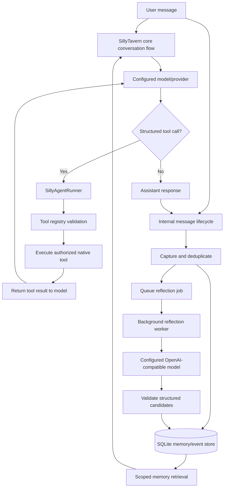

<!-- SillyAgent canonical homepage; refreshed 2026-10-23 -->

# SillyAgent

**A community-maintained SillyTavern fork with a native, core-integrated agent harness.**

> **You are reading the SillyAgent `main` branch.** This is the canonical branch for the fork's native harness and memory integration. The legacy `release` branch is retained separately and does not contain the complete SillyAgent core integration.

> **SillyAgent is a fork of [SillyTavern](https://github.com/SillyTavern/SillyTavern).** It retains the upstream application as its foundation and adds fork-specific backend, lifecycle, and agent-runtime changes. This is an independent community fork, not an official SillyTavern release.

SillyTavern continues to provide the conversation UI, provider integrations, and user-data environment. SillyAgent adds agent capabilities directly into the fork's backend and core conversation flow. It is **not a browser extension** and does not require installing a separate SillyTavern extension.

## What SillyAgent adds

- **Native tool harness:** structured model tool calls run through a tool registry that validates tool names, input schemas, toolsets, and write permissions.
- **Persistent memory:** captured conversation turns, memories, and proposals are stored in SQLite with character/chat-scoped retrieval.
- **Automatic lifecycle capture:** internal SillyTavern message events drive capture and deduplication. No trigger word is required.
- **Background reflection:** an optional backend worker can turn bounded conversation context into durable memories and reusable procedural skills when a reflection provider is configured and enabled.
- **Procedural skills:** persistent character-scoped skills can be searched and managed through native tools.
- **Roleplay state tools:** world, character, and scene state, lore search, scene advancement, and dice rolls are available to the model through the harness.
- **Deletion-aware storage:** chat and character lifecycle hooks clean up associated state and guard against late asynchronous work recreating deleted data.

## How the flow works



The harness has two connected paths: the live generation/tool-call loop and the lifecycle-driven memory path. Capture is driven by SillyTavern's internal events. Tools run when the model emits a supported structured tool call. Reflection jobs are queued automatically after assistant turns, then processed when reflection is enabled and its provider credentials are available.

**No manual trigger word, slash command, or repeated user action is needed.** Background reflection does require a valid provider/model/credential configuration and must be enabled. See the [architecture guide](docs/sillyagent-architecture.md) for the detailed execution flow.

## Quick start

Requirements: Git and Node.js 20 or newer, including npm. For the full SillyAgent feature set, use Node.js 22.5 or newer (Node.js 24 is recommended). On Node.js 20, the underlying SillyTavern app can run, but SQLite-backed SillyAgent memory, roleplay state, and the background worker are unavailable.

```sh
git clone --single-branch --branch main https://github.com/Bulldogshot10/SillyAgent.git
cd SillyAgent
bash start.sh
```

The startup script installs production dependencies and launches the server. Open the local address printed in the terminal, commonly `http://127.0.0.1:8000`.

- [Installation guide](docs/installation.md), including Android Termux.
- [Architecture and execution flow](docs/sillyagent-architecture.md).
- [Fork change inventory](docs/fork-changes.md): modification summary and principal changed paths.
- [Documentation index](docs/README.md).

## Background reflection setup

Background reflection is disabled by default. Configure it directly in SillyAgent's WebUI:

1. Open the **SillyAgent Agent Core** drawer using the brain icon.
2. Under **Background reflection and self-improvement**, enter your OpenAI-compatible chat-completions endpoint and exact model ID.
3. Choose the credential slot from **SillyTavern Secrets**. Add and activate the API key in SillyTavern's Secrets manager first; the selector stores only the secret key identifier, not the raw API key.
4. Press **Test connection** to send a short request to the draft endpoint and model. This test does not save the draft or enable the worker.
5. Enable **Enable autonomous background reflection**, then press **Save background worker settings**.

The status text reports whether the endpoint/model are configured and whether the selected credential has an active secret. Non-loopback endpoints must use HTTPS; plain HTTP is accepted only for localhost/loopback services.

For headless/manual setup, the configuration is stored at:

```text
<SillyTavern data root>/sillyagent/reflection-provider.json
```

The `secretKey` field refers to a secret already stored in SillyTavern's secret manager. **Do not paste the raw API key into this JSON file.** See the [installation guide](docs/installation.md#configuring-background-reflection) for the full WebUI flow, endpoint details, and troubleshooting.

## Project status

The `main` branch is the primary development branch for this fork and includes the SillyAgent core integration. APIs and behavior may evolve as development continues. SillyAgent is built around SillyTavern's existing application, provider, and user-data systems; it is not a standalone framework that can be dropped into an unrelated host without adaptation.

## Upstream and support

- Upstream SillyTavern: https://github.com/SillyTavern/SillyTavern
- Upstream documentation: https://docs.sillytavern.app/
- Upstream community: https://discord.gg/sillytavern

Report issues specific to this fork in this repository. For behavior reproduced on an unmodified upstream SillyTavern installation, consult the upstream project and documentation.

## License and third-party notices

This fork retains the repository's **GNU Affero General Public License v3.0 (AGPL-3.0)**. See [LICENSE](LICENSE), [NOTICE](NOTICE), and [THIRD_PARTY_NOTICES.md](THIRD_PARTY_NOTICES.md). The third-party notice includes the dependency inventory associated with the checked-in `package-lock.json`; each dependency's own license file remains authoritative for its exact terms.
