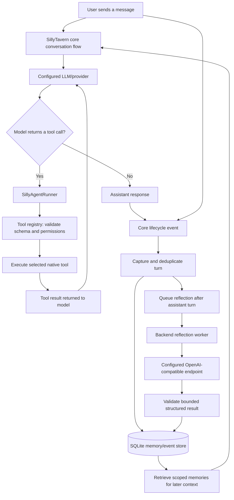

# SillyAgent: Architecture and Execution Flow

SillyAgent is a native, core-integrated agent runtime in this SillyTavern fork. It is not installed as a browser extension and it does not replace SillyTavern's user interface, provider configuration, or conversation system. The fork integrates the runtime with SillyTavern's message lifecycle and backend routes.

## The big picture

This diagram shows two connected paths: the live generation/tool path, and the lifecycle-driven memory path. Both are integrated into the fork's core flow.

## 1. Live model and tool-call path

SillyTavern sends the conversation to the configured provider using its existing generation pipeline. When the model emits a structured tool call through the supported tool-calling path, SillyAgent's runner handles the logical assistant turn.

The runner dispatches each requested tool through a registry. The registry validates the tool name, input schema, write permissions, and toolset. The result is returned to the model, which may produce another tool call or the final assistant response. The runner bounds a logical turn to at most 8 tool rounds and 24 tool calls.

Available tool families include memory search/proposal, procedural-skill search and management, world state, character state, scene state/advance, lore search, and dice tools. A tool is not authorized merely because the model asks for it: registry validation and the active permission settings still apply.

## 2. Automatic conversation capture

Core lifecycle integration forwards user and assistant turns to the native SillyAgent backend. The backend validates identifiers and inputs, deduplicates repeated captures, and stores captured turns as events. Persistent memory uses SQLite-backed storage.

Data is scoped to the active character and/or chat. Character-scoped history can inform that character's long-horizon memory, while chat-scoped retrieval stays within the correct chat partition. This is intended to prevent accidental mixing of unrelated characters' memories.

No user-defined trigger word is required. The triggers are internal lifecycle events emitted by SillyTavern, not magic words typed into a conversation.

## 3. Memory retrieval

Before later responses, the core integration can request relevant stored context through the native retrieval path. SillyAgent searches the applicable memory scope and returns the context for the conversation pipeline to use.

The persistent store distinguishes captured events, accepted memories, and pending proposals. Explicitly deleted or rejected items are guarded by tombstones so background reflection cannot quietly resurrect them from stale source context.

## 4. Automatic reflection and procedural learning

After an assistant turn is captured, SillyAgent can enqueue a reflection job. A backend-owned worker checks the queue approximately every 3 seconds. The worker only performs model reflection when a reflection provider is configured and enabled and the selected credential is available.

The worker prepares a bounded transcript, asks an OpenAI-compatible model for structured memory and skill candidates, validates the response, and re-checks that the evidence and the job's lifecycle claim are still valid before writing. Each ordinary reflection pass uses at most 24 recent turns from the active chat. For character-level context, the total evidence window is bounded to at most 160 turns. Content and provider responses are also size-bounded.

Reflection can produce reusable memories and procedural skills from meaningful facts, preferences, events, goals, world-state information, and successful or corrected workflows. Whether the background reflection runs depends on provider configuration; capture and tool execution do not require a user-visible trigger phrase.

## 5. Data lifecycle and deletion

Chat and character deletion are wired into core lifecycle paths. SillyAgent marks deletion in progress, removes the associated scoped records, and prevents late in-flight requests from recreating state while the source chat/character is being removed. A deleted chat partition is not reactivated until the corresponding source chat exists again. Character deletion also clears character-owned memory/state and procedural skills.

These guards matter because capture and reflection are asynchronous: a request started before deletion must not repopulate data after deletion completes.

## 6. Native API and guardrails

The native endpoint is mounted at `/api/agent/tools` within SillyTavern's private API surface. The route has a 16 KiB request-body limit and validates active chat/character context. Tool execution uses allowlisted toolsets and write permissions. Tool calls, schemas, results, timeouts, provider response sizes, and state versions are bounded or validated.

The reflection provider can be configured through the native **SillyAgent Agent Core** WebUI drawer, including a draft **Test connection** action, or via the native provider endpoints. Settings are persisted at `<SillyTavern data root>/sillyagent/reflection-provider.json`. Provider credentials are referenced through SillyTavern's secret store rather than being saved directly inside this configuration file. Testing a draft sends one short OpenAI-compatible chat-completions request and does not save or enable the draft. Non-loopback reflection endpoints must use HTTPS; plain HTTP is permitted only for loopback services.

## 7. Does it need a trigger word or manual action?

No manual trigger word, slash command, or repeated user action is required for the automated flow.

- Capturing turns is driven by SillyTavern's internal message lifecycle.
- Reflection is queued by the captured assistant-turn lifecycle and processed by the backend worker when the provider is enabled.
- Tool execution begins when the model emits a structured tool call in the supported generation path.

The key distinction is that automation still has internal event conditions and configuration prerequisites. In particular, background reflection is off until a valid provider/model/credential setup is enabled.
